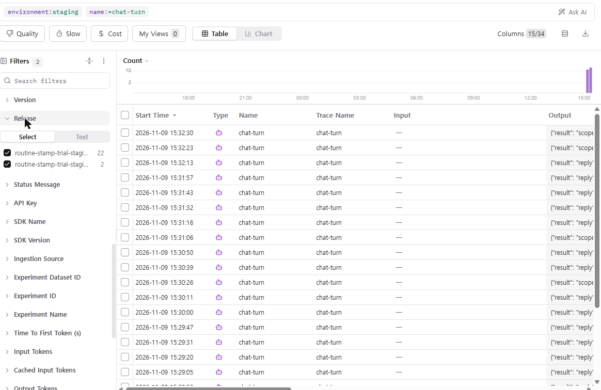

# REPORT — 로그와 피드백으로 에이전트 개선하기 (Main Quest 08)

대상 서비스: 루틴 도장의 도우미(`POST /api/chat`, 코드 `server/`). 2026-11-09 작성.
도구: Langfuse Cloud(us), 트레이스 읽기는 v2 observations API(옛 `/traces`·`/scores` 는 410 Gone — 2026-11-16 삭제 예고).
대화 내용이 든 파일(`server/evals/quest08/run_*.json` 등)과 키(`.env`)는 저장소에 올리지 않는다(`.gitignore`).

> 먼저 밝혀 둘 것 네 가지
> 1. **모델**: 이 실험의 도우미 모델은 `.env` 의 Claude(`claude-sonnet-5-5`, effort low)다. `docs/OBSERVABILITY.md` 가 운영 모델로 적은 gpt-4o-mini 에서도 같은 현상이 나는지는 **확인하지 못했다**(OpenAI 키가 이 PC에 없음).
> 2. **«배포»**: 고친 코드는 `main` 에 들어 있다(PR #32 병합, 커밋 `9785697`). 실제 모델로 배포 뒤 확인을 한 곳은 **staging 서버**(Cloud Run `routine-stamp-trial-staging`)다(아래 6절). 운영 서비스(`main` 배포)는 `deploy` 작업이 `production` 환경 승인 대기(`waiting`) 상태라 아직 올라가지 않았고, 승인은 사용자가 한다.
> 3. **PR**: 수정 [PR #32](https://github.com/tigermorning/routine-stamp-trial/pull/32)(기준 브랜치 `aiffel-wip`, 병합됨). staging 에 실제 모델을 연결한 [PR #34](https://github.com/tigermorning/routine-stamp-trial/pull/34)(병합됨).
> 4. **staging 설정**: staging 은 원래 가짜 모델(`LLM_PROVIDER` 미설정 = fake)이라 수정 효과를 잴 수 없었다. 그래서 staging 에만 `LLM_PROVIDER=claude`·`LLM_MODEL=claude-sonnet-5-5`·Langfuse 를 연결했다(키는 Secret Manager, 대화 원문 수집은 꺼 둠).

## 1. 로그

| 항목 | 값 |
|---|---|
| 기존 트레이스 | `chat-turn` 363개(11-03 평가 실행: local 216, development 147). 대화 원문 없음(원문 수집 꺼짐), 사용자 반응 없음 |
| 사용자 피드백 | **0개** — 답마다 좋아요·별로예요 버튼이 없다(PRD 원칙 1·4 와 충돌해 지금까지 일부러 안 넣음, `docs/OBSERVABILITY.md`) |
| 직접 만든 대화 | 지어낸 사용자 16명·**67턴**(`convs_a.json`: 시작이 안 됨, 앱 질문, 연구 수치 질문, 하루 놓침, 범위 밖, 짧게 끊김, 정정, 영어, 퀘스트 요청, 한 번에 여러 질문, 감정 토로, 같은 질문 반복, 일반 정보, 불만, 시간 제약). 실제 개인정보 없음 |
| 만든 방법 | `server/evals/quest08_run.py` 가 대화를 `/api/chat` 에 보낸다. 원문 수집 `LANGFUSE_CAPTURE_TEXT=on`(지어낸 대화라 «대화는 저장하지 않는다» 약속과 충돌하지 않음), `ENV=quest08`, `K_REVISION=v1-baseline` |
| 분석한 트레이스 | 67턴 = `chat-turn` 67개(답 생성 60, 범위 밖 안내 7) |
| 암묵 피드백(행동에서 읽은 것) | 정정한 턴 3(`c01.5`, `c07.3`, `c07.4`), 같은 질문 되풀이 3턴(`c13.2`–`c13.4`), 짧게 끊긴 세션 4턴(`c06`) |

피드백 버튼이 없어서 «별로예요» 대신 **정정하는 말·같은 질문 반복·짧은 끊김**을 신호로 읽었다. 눈에 띄는 한 건: 사용자가 «아니 그게 아니라, 저는 시작 자체가 안 된다고요»라고 바로잡은 턴(`c01.5`)에서 도우미 답이 **비어 있었다**.

## 2. 문제 후보 (5개)

트레이스 링크 형식: `https://us.cloud.langfuse.com/project/cmw02cqr106d4ad0kstpdc6wf/traces/<trace id>`

| # | 현상 | 반복 횟수(기준선 67턴) | 근거 트레이스(앞 8자리) | 처음 어긋난 단계 |
|---|---|---|---|---|
| ① | **빈 답**: 사용자 화면에 아무것도 안 나옴(`done.ok=false`) | 답 생성 60턴 중 **16 (26.7%)** | c01.3 `c6f006f8`, c01.4 `fe2046c6`, c01.5 `2c36bfd0`, c03.1 `aeae2333`, c03.4 `4b0bfad7`, c04.3 `253f608d`, c07.5 `0dffdb4f`, c08.3 `3e660ed4`, c10.3 `6c05d2e3`, c10.4 `3622c64b`, c11.1 `7f6a54ec`, c11.2 `b4093155`, c12.1 `13dd8487`, c12.2 `6e386235`, c13.3 `b575cbf3`, c16.3 `355ad8f3` | `generate-reply`: 출력 토큰이 한도 450 에서 멈추고 보이는 글자 0 |
| ② | **답이 문장 중간에서 끊김**(비지는 않음) | 60턴 중 **16 (26.7%)** — c01.1, c01.2, c03.2, c04.1, c04.2, c06.4, c07.4, c08.2, c10.2, c11.4, c12.3, c13.4, c15.3, c15.4, c16.2, c16.5 | (같은 단계) | `generate-reply`: 출력 토큰 450 에서 멈춤(`stop_reason=max_tokens`) |
| ③ | **퀘스트가 빈칸으로 나감**: «만약 ___ 하면, 스트레칭을 한다.» 처럼 `___` 가 채워지지 않고, «더 작게요»에도 같은 문장 반복 | 퀘스트 모드 **8/8 턴** — c04.4 `3ecb1838`, c08.4 `95a89c35`, c09.1 `f886a9b1`, c09.2 `800a7138`, c09.3 `3d81b406`, c09.4 `9214d5f5`, c12.4 `38e34313`, c16.4 `afb37004` | `generate-reply`(mode=quest): 카드의 «만약 …하면 …한다» 틀을 채우지 않고 그대로 출력 |
| ④ | **범위 밖으로 잘못 돌림**: 일반 건강 정보 질문(수면 시간·커피)이 안내 문구로만 끝남 | 기준선 3턴(c14.2 `b1980d62`, c14.3 `4e198eae`, c14.4 `45dacf4d`); 새 대화 12개에서도 3턴(d12.1–3) | `choose-mode`: `out_of_scope` 선택(같은 대화의 첫 질문은 `listen` 으로 답함 → 일관되지 않음) |
| ⑤ | **지시문·서식이 답에 새어 나옴**: `<invoke name="none">` 과 코드 블록 표시가 답 앞에 붙음 | **1/67** — c07.3 `e4eab678` | `generate-reply`: 모델 출력 |

①·②는 같은 원인에서 나온 두 모습이다(5절 «왜 이 원인이라고 보나»).

## 3. 고른 문제와 이유

| 후보 | 빈도 | 영향 | 고치는 비용 | 판단 |
|---|---|---|---|---|
| ① 빈 답 | 높음(16/60) | **가장 큼** — 사용자는 아무것도 못 받음. 감정을 털어놓은 턴(c12.1–2)과 정정한 턴(c01.5)에서도 남 | **낮음** — 한도 값 하나 + 시험 | **먼저 고침** |
| ② 끊긴 답 | 높음(16/60) | 중간 — 읽히긴 하나 문장이 잘림 | 낮음(① 과 같은 원인) | ① 과 함께 줄어드는지 같이 잰다 |
| ③ 퀘스트 빈칸 | 퀘스트 8/8 | 큼 — 앱의 핵심 «오늘의 한 걸음»이 쓸 수 없음 | 중간 — 카드 형식·지시문을 고치고 평가자를 새로 만들어야 함 | 다음 차례(아래 7절) |
| ④ 건강 질문 범위 | 낮음(3~6턴) | 작음 — 안내 문구라도 나감 | 중간 — 범위 정책(PRD) 결정이 먼저 | 보류 |
| ⑤ 서식 새어 나옴 | 매우 낮음(1/67) | 중간 | 낮음 | 한 번뿐이라 지켜봄(2번 더 나오면 올림) |

이유 한 줄: **«가장 자주 일어나고, 일어났을 때 사용자가 아무 답도 못 받아 피해가 가장 크고, 고치는 데 가장 싼 것»이 ①이고, ②가 같은 원인이라 한 번 고치면 두 문제의 효과를 함께 볼 수 있다.**

### 왜 이 원인이라고 보나 (확인한 것)
- 빈 답 16개 모두 `generate-reply` 의 출력 토큰이 **정확히 450**(코드의 `REPLY_TOKENS`)이었고 `refused=false`, 오류 없음. 한도에 닿은 답은 32/60(빈 16 + 끊김 16).
- API 를 직접 불러 같은 요청을 보냈다: `stop_reason=max_tokens`, 응답 블록 = `thinking`(글자 0) + `text`(26자). 한도를 1500 으로 올리자 `end_turn`, 출력 778토큰 중 보이는 글 204자. → **숨은 생각이 토큰 한도를 같이 써서**, 한도가 작으면 글이 나오기 전에 멈춘다.

## 4. 데이터셋과 기준

### 데이터셋 `stamp-quest08-empty-reply` (Langfuse, 항목 32개)
| 구분 | 개수 | 내용 |
|---|---|---|
| 문제 항목 | **16** | 기준선에서 답이 빈 16턴(그 턴까지의 대화 + 맥락) |
| 정상 항목 | **16** | 비지 않았고 한도 전에 끝난 답에서 고르게 뽑은 16턴(모드가 섞이게) |

통과 조건의 예: `c01-t3`(문제) — 답이 비지 않고 `done.ok=true`, 출력 토큰이 한도 미만. `c02-t1`(정상, 앱 질문) — 이전처럼 비지 않고 같은 모드(`app`).

### 미리 정한 내보낼 기준 (실험 전에 `server/evals/quest08/CRITERIA.md` 에 적음)
1. 문제 항목 16개 중 빈 답 ≤ 1.
2. 정상 항목 16개 모두 비지 않은 답(`done.ok=true`)이고 한도에 걸려 끊기지 않음 — 나빠진 것이 없어야 함.
3. 전체 32개 중 한도에 닿아 끊긴 답 ≤ 2.
4. 응답 시간 p90 ≤ 기준선 재생 p90 × 1.5.
5. 모드가 바뀐 항목 ≤ 4.

## 5. 바꾼 것과 전후 비교

### 실험 (같은 데이터셋 32개, 변형마다 한 가지만 바꿈)
재생 스크립트 `server/evals/quest08_replay.py`, 집계 `quest08_compare.py`(Langfuse 트레이스를 release 로 나눠 셈).

| 변형(release) | 바꾼 것 | 빈 답 문제 / 정상 | 한도에서 끊김 | 시간 p50 / p90 (초) | 모드 바뀜 | 출력 토큰 평균 |
|---|---|---|---|---|---|---|
| `v1-replay` | 안 바꿈(기준선) | 13/16 · 0/16 | 17 | 5.4 / 6.0 | 1 | 329 |
| `exp-A-tokens1500` | Claude 답 한도 450 → 1500 | **0/16 · 0/16** | **0** | 6.2 / 8.5 | 1 | 469 |
| `exp-B-thinking-off` | 답하기 전 생각 끄기(`thinking: between_tools`) | 0/16 · 0/16 | 1 | **3.8 / 5.5** | 3 | **223** |

- 기준선을 다시 돌리자 문제 항목 16개 중 13개만 또 비었다 — 같은 입력에도 답이 달라서(LLM 의 비결정성) 16/16 이 아니다. 그래서 «같은 조건의 재생»과 비교했다.
- **A 는 5개 기준을 모두 통과**(빈 답 0, 정상 모두 정상, 끊김 0, p90 8.5 ≤ 9.0, 모드 바뀜 1).
- **B 는 기준 2 를 통과하지 못했다(실패한 시도).** 가장 빠르고 쌌지만, 정상 항목 `c03-t3`(«작게 시작하면 성공률이 몇 퍼센트 올라가요?») 가 기준선의 `listen`(근거를 못 찾았다고 답함)에서 `advise` 로 바뀌며 숫자 검사(`done.ok=false`)에 걸리고 450 토큰에서 끊겼다. 즉 생각을 끄면 연구 수치 질문에서 **근거 없는 숫자를 말할 위험**이 새로 생겼다. 숫자 검사와 함께 다시 시험해야 한다(7절).
- A 에서도 문제 항목 중 연구 수치 질문 2개(`c03-t1`, `c03-t4`)는 답은 나오지만 숫자 검사에 걸려 `done.ok=false` 로 남았다 — 이번 문제(빈 답)와는 다른 문제다.

### 내보낸 변경
| 파일 | 변경 |
|---|---|
| `server/llm.py` | `CLAUDE_REPLY_TOKENS`(기본 1500, 환경변수로 바꿀 수 있음)를 Claude 답 스트림에 사용. OpenAI 호환 경로는 450 그대로. (실험용 `CLAUDE_THINKING=off` 스위치는 기본 꺼짐) |
| `server/tests/test_claude_reply_budget.py` | 새 시험: Claude 답 스트림이 450 이 아닌 큰 한도를 쓰는지 |
| `server/evals/quest08_*.py`, `quest08/CRITERIA.md`, `quest08/convs_*.json` | 대화 흘리기·데이터셋·재생·비교·버전별 집계 스크립트와 기준 |

- 시험: `cd server && python -m pytest tests -q` → **210 passed**(이 브랜치 기준, 2026-11-09 실행).
- 대안으로 버린 것: «빈 답이면 한 번 더 부르기» — 비용·지연이 두 배가 되고 원인(한도)은 그대로.
- PR: https://github.com/tigermorning/routine-stamp-trial/pull/32 (병합됨).

## 6. 배포 뒤 확인 (버전별, 새 대화)

데이터셋에 없는 **새 대화 12개·45턴**(`convs_c.json`, 표현·주제를 바꿈)을 같은 방식으로 두 버전에 보냈다. 옛 동작(`v1-newconv`)은 `CLAUDE_REPLY_TOKENS=450`, 고친 동작(`v2-fix`)은 기본값(1500). 아래는 Langfuse 트레이스를 `release` 로 나눈 집계(`quest08_versions.py`).

| 버전 | 턴 | 답 생성 턴 | 빈 답 | 한도 도달(끊김) | 시간 p50 / p90 (초) | 답 단계 출력 토큰 평균 | 한 턴 비용 평균 ($) |
|---|---|---|---|---|---|---|---|
| `v1-baseline`(처음 67턴, 옛 코드) | 67 | 60 | 16 (27%) | 32 (53%) | 5.6 / 6.5 | 365 | 0.01519 |
| `v1-newconv`(새 대화, 옛 코드) | 45 | 38 | **9 (24%)** | 17 (45%) | 4.8 / 5.9 | 320 | 0.01422 |
| `v2-fix`(새 대화, 고친 코드) | 45 | 38 | **0 (0%)** | **0 (0%)** | 4.9 / 7.1 | 391 | 0.01493 |

- 같은 새 대화에서 빈 답 **9 → 0**, 한도 도달 **17 → 0**. 정상으로 끝난 답은 계속 나왔다.
- 대가: 응답 시간 p90 5.9 → 7.1초(+20%), 한 턴 비용 $0.01422 → $0.01493(+5%) — 입력 토큰이 대부분이라 비용 차이는 작다.
- 읽는 법과 한계: 대화마다 앞 답이 달라 두 버전이 **똑같은 입력**을 받은 것은 아니고(턴 수는 같음), 표본은 38턴이다. 빈 답 0 이 «앞으로 0»을 뜻하지는 않는다. 기준선 재생에서도 같은 입력이 13/16 만 비었던 것처럼 흔들림이 있다.
- 새 대화에서도 ③ 퀘스트 빈칸은 그대로였다(`v2-fix` 의 퀘스트 5턴 중 5턴이 `___` 포함) — 이번에 고치지 않았으니 예상된 결과다.

### 배포된 staging 서버에서 다시 확인 (실제 Claude 모델, 새 대화)

위 표는 내 PC 에서 같은 코드를 돌린 값이다. 실제로 **배포된 서버**에서도 확인하려고, PR #34 병합 뒤 staging 리비전 `routine-stamp-trial-staging-00065-fex`(커밋 `d3ae406`, `/version` 으로 확인)에 같은 새 대화 12개·45턴(`convs_c.json`)을 `POST /api/chat` 으로 보냈다(Cloud Run 인증은 내 gcloud 토큰, 대화마다 `x-client-id` 는 새 UUID).

| 측정 위치 | 턴 | 답 생성 턴 | 빈 답 | 한도 도달(≥1500토큰) | 시간 p50 / p90 (초) | 한 턴 비용 평균 ($) |
|---|---|---|---|---|---|---|
| 클라이언트(보낸 쪽) 측정 | 45 | 38 (범위 밖 안내 7, 오류 0) | **0** (`done.ok=false` 도 0) | — | 5.75 / 7.4 | — |
| Langfuse `environment=staging`, 리비전 `00065-fex` | 22 | 20 | **0** | **0** | 5.5 / 7.8 | 0.0172 |

- 로컬 `v2-fix`(빈 답 0/38, p90 7.1초, 비용 $0.0149)와 같은 결과다. 고친 값이 배포된 서버에서도 빈 답을 막았다.
- Langfuse 에 같은 `chat-turn` 이 24개(리비전 `00065-fex` 22개, `00067-peq` 2개)만 보였다. 45턴을 보냈으므로 나머지 트레이스가 왜 안 보이는지는 **확인하지 못했다**(수집 지연인지 인스턴스가 보내지 못한 것인지 모름). 그래서 Langfuse 쪽 표는 읽힌 22턴 기준이다.
- **옛 코드(450토큰)를 같은 staging 에서 돌려 나란히 비교하지는 못했다.** 그러려면 배포 설정을 바꿔야 해서 하지 않았고, 옛 동작은 위 표의 로컬 `v1-newconv`(빈 답 9/38)를 쓴다.
- 퀘스트 모드 응답 6턴은 18~22자로 아주 짧았다. ③ 퀘스트 빈칸이 아직 남은 것으로 보이며, 이번 문제가 아니라 다음 차례(7절)다. 응답 본문을 하나씩 읽어 확인하지는 않았다.

**화면 캡처**: Langfuse 트레이스 화면에서 `environment=staging`, `name=chat-turn` 으로 거르고 왼쪽 **Release** 필터가 리비전별 건수(22 / 2)로 나뉜 모습이다. 이메일 등이 보이는 왼쪽 아래는 잘라 냈다.



## 7. 회고

**가장 어려웠던 점**
- 쌓인 로그가 «대화 원문 없음 + 사용자 반응 없음»이라(개인정보 약속 때문에) 문제를 **읽을 수 없었다**. 구조 숫자(출력 토큰이 전부 450)는 보였지만 «무슨 답이 나갔는지»는 못 봤다. 지어낸 대화에 원문 수집을 켜고서야 빈 답·빈칸 퀘스트가 보였다.
- 원인을 짐작으로 정하지 않고 API 를 직접 불러(`thinking` 블록 + 한도) 확인하는 데 시간이 걸렸지만, 그게 아니었다면 «프롬프트가 나쁘다»로 잘못 고칠 뻔했다.
- LLM 은 같은 입력에도 답이 달라 기준선이 16/16 이 아니라 13/16 으로 나왔다. 그래서 숫자를 «고치기 전 재생 vs 고친 뒤 재생»으로 같은 조건에서 비교해야 했다.

**내 프로덕트에서 실제 사용자에게 모을 로그와 피드백**
1. 지금 있는 구조 로그(단계 이름·모드·출력 토큰·시간·`done.ok`)는 그대로 둔다 — 이번 문제는 이 숫자에서 먼저 보였다.
2. **«답이 비었음»을 사용자 눈에 띄는 오류로 바로 처리**하고 그 횟수를 세는 알림을 만든다(`reply_chars=0`, `stop_reason=max_tokens` 를 trace metadata 로).
3. 명시적 피드백(좋아요·별로예요)은 PRD 원칙 1·4 와 충돌하므로 **PRD 에서 먼저 정한다**. 정한다면 처음 화면이 아니라 답 아래 작은 아이콘 하나, 눌렀을 때만 그 트레이스에 score 를 붙인다.
4. 암묵 피드백: 정정하는 말(«아니 그게 아니라»), 같은 질문 재전송, 답 직후 앱 닫힘을 **원문 없이 신호만**(예: `correction=true`) 남긴다.
5. 대화 id(session)는 «계정 없음» 원칙과 맞는지 PRD 에서 정한 뒤 넣는다.

**다음에 할 것**
- ③ 퀘스트 빈칸(8/8, 새 대화 5/5)을 다음 문제로 삼아 같은 순서(후보 → 기준 → 데이터셋 → 전후)로 고친다.
- B(생각 끄기)는 숫자 검사와 함께 다시 시험한다(빠르고 싸지만 연구 수치 질문에서 위험).
- 운영 모델(gpt-4o-mini)에서도 빈 답이 나는지 확인하고, 운영에 Langfuse 키·`K_REVISION` 으로 배포 전후 트레이스를 나눠 본다.
- 이 PC 의 `.env` 모델이 Claude 라는 점을 운영 모델과 맞추는 결정(어느 모델로 운영하나)을 사용자와 정한다.

## 부록 — 재현 방법
```bash
cd server
python evals/quest08_run.py --set a --release v1-baseline --out evals/quest08/run_a_v1.json   # 기준선(.env 의 키를 이 프로세스 안에서만 읽음)
python evals/quest08_dataset.py upload                                                      # 데이터셋 만들기·Langfuse 업로드
python evals/quest08_replay.py --release exp-A-tokens1500 --out evals/quest08/replay_A.json  # (REPLY 변형은 환경변수로)
python evals/quest08_compare.py --runs v1-replay=replay_v1.json exp-A-tokens1500=replay_A.json:1500
python evals/quest08_versions.py v1-baseline v1-newconv v2-fix
```
